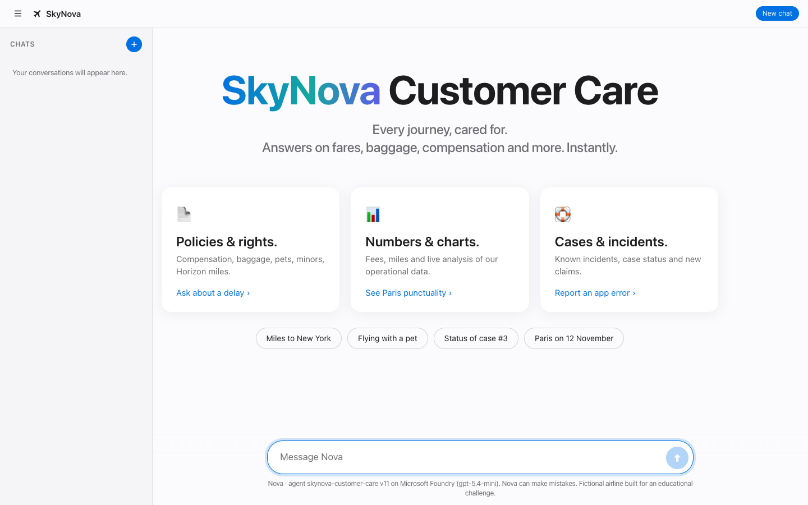

# Challenge-Agent-MS-Foundry ✈️ SkyNova Airlines Customer Care Agent

An agentic solution built on **Microsoft Foundry** with the **Microsoft Foundry SDK (Python)**. The agent is a polite, professional customer-service assistant for **SkyNova Airlines**, a fictional airline.

---

> 📘 **Step-by-step study guide (Spanish):** [docs/GUIA_PASO_A_PASO.md](docs/GUIA_PASO_A_PASO.md). It includes how to restart the web app after rebooting.

## 📋 Challenge instructions

In this challenge you build an agentic solution for a scenario of your choice. It must meet these requirements:

1. **The agent uses an existing model** deployed in our Foundry Project.
2. **The agent is created in Foundry**, either in the UI or programmatically with the Foundry SDK.
3. **The agent is configured with:**
   - A **system message / instructions** that guide the agent's behaviour
   - **Code Interpreter**
   - **An MCP server integration** (research which one suits the scenario)
   - **Custom data:** sample PDF documents created with any GenAI and given to the teacher, who creates the index that the agent connects to
4. **A program that interacts with the agent**, sending prompts and receiving responses:
   - It handles authentication and the connection to the agent
   - The terminal is the first interface
5. **(EXTRA)** A web interface for interacting with the agent.

---

## 🛫 Scenario: SkyNova Airlines

SkyNova Airlines (IATA code `NV`) is a fictional full-service carrier based in Madrid (hub MAD, base BCN). It has 44 aircraft and flies 26 routes across Spain, Europe and the Americas.

The agent answers customer questions in a professional, polite customer-service tone:

| Capability | How the agent uses it |
|---|---|
| **Instructions** | Customer-service persona that follows SkyNova's *CARE* model (Connect, Acknowledge, Resolve, Empower) |
| **RAG (custom data)** | Fare rules, baggage fees, EU 261 compensation, pets and minors, loyalty programme, network and fleet, Q3 2026 performance report |
| **Code Interpreter** | Fee and compensation calculations, miles calculations, charts and analysis of operational performance data |
| **MCP server (GitHub)** | Case management: reads known incidents and case status, and creates customer cases as Issues in [`skynova-customer-cases`](https://github.com/luis-martin-b/skynova-customer-cases) |

## 📁 Repository structure

```
├── data/
│   ├── pdfs/                 # Knowledge base for the index (7 PDFs)
│   ├── csv/                  # Performance dataset for Code Interpreter
│   └── test_questions.md     # Evaluation prompts with expected answers
├── agent/
│   └── system_instructions.md # Agent instructions (paste into Foundry)
├── app/
│   ├── skynova_client.py     # Shared core: auth, connection, conversation, tool/citation/chart parsing
│   ├── cli.py                # Terminal chat interface
│   ├── web.py                # Web app (FastAPI backend)
│   └── static/               # Web front-end (HTML, CSS, JS)
├── data_generation/
│   ├── skynova_data.py       # Shared master data (routes, fleet, performance generator)
│   └── generate_pdfs.py      # Builds the PDFs + CSV with reportlab
└── requirements.txt
```

### Knowledge base (`data/pdfs/`)

| File | Content |
|---|---|
| `SkyNova_01_Fares_and_Baggage_Policy.pdf` | Fare families, change and refund rules, baggage allowances and fees, check-in deadlines |
| `SkyNova_02_Passenger_Care_and_Compensation_Policy.pdf` | Delays, cancellations, denied boarding (EU 261), SkyNova Care Promise, baggage claims |
| `SkyNova_03_Special_Assistance_and_Travel_Needs.pdf` | Reduced mobility, pets, unaccompanied minors, infants, pregnancy, sports equipment, special meals |
| `SkyNova_04_Horizon_Loyalty_Program.pdf` | Tiers, earning and award charts, upgrades, partners |
| `SkyNova_05_Route_Network_and_Fleet_Guide.pdf` | Routes, flight numbers, schedule, fleet, Wi-Fi, onboard menu, lounges |
| `SkyNova_06_Operational_Performance_Report_Q3_2026.pdf` | KPIs, delay causes, route performance per month, complaints |
| `SkyNova_07_Customer_Service_Guide_and_FAQ.pdf` | Contact channels, CARE model, FAQs, tone examples, escalation |

All data is internally consistent: routes, distances, compensation bands and fares match across documents.

## 💻 Terminal client

The client is built with the **Microsoft Foundry SDK** (`azure-ai-projects` 2.x) and calls the agent through the OpenAI-compatible **Responses API** with an `agent_reference`.

**How it works**
1. **Authentication:** `DefaultAzureCredential` (Microsoft Entra ID). Locally it uses your `az login` session; once deployed it can use a managed identity. No API keys are stored in the code.
2. **Connection:** `AIProjectClient(endpoint, credential)` checks that the agent exists with `agents.get()`, and `get_openai_client()` returns an authenticated client.
3. **Conversation:** `conversations.create()` keeps multi-turn memory on the Foundry side. `/new` starts a fresh one.
4. **Responses:** `responses.create(conversation=..., input=..., extra_body={"agent_reference": {...}})`.
5. **Parsing:** the client shows which tools were used (🔎 knowledge base, 🐍 Code Interpreter, 🐙 GitHub) and decodes knowledge-base citations into PDF names. It downloads charts from the Code Interpreter container to `outputs/` and opens them.

**Run it in GitHub Codespaces (recommended, nothing to install)**
1. On GitHub: **Code → Codespaces → Create codespace on main**. Python, the Azure CLI and the requirements install automatically.
2. In the Codespace terminal:
   ```bash
   az login --use-device-code     # open the link, enter the code, sign in with your Foundry account
   python app/cli.py
   ```
   Charts are saved to `outputs/`. Click them in the Explorer to view them.

**Run it locally**
```bash
python -m venv .venv && source .venv/bin/activate
pip install -r requirements.txt
cp .env.example .env          # set FOUNDRY_PROJECT_ENDPOINT and FOUNDRY_AGENT_NAME
az login                      # same account as the Foundry project
python app/cli.py
```
Commands: `/new` (new conversation), `/help`, `/exit`.

## 🌐 Web app (EXTRA)

A chat page in the style of a modern product website, served by **FastAPI**. It reuses the same core (`skynova_client.py`), so authentication and agent logic are shared with the terminal client.



- Large headline, frosted-glass navigation bar and suggestion tiles that send example prompts
- **Chat history** sidebar: every conversation is saved (`history/*.json`, local and git-ignored). You can reopen a chat and keep talking, because the Foundry conversation keeps the context, or delete it
- Chat thread: user bubbles, Markdown answers, tool badges (🔎 🐍 🐙), knowledge-base sources, and Code Interpreter charts shown inline (click to enlarge)
- Each browser tab gets its own Foundry conversation; **New chat** starts a fresh one
- Automatic light and dark mode, responsive layout for phones

**Architecture:** browser → `POST /api/chat` (FastAPI) → `SkyNovaAgent.ask()` → Foundry Responses API (`agent_reference`). Charts are downloaded from the Code Interpreter container and served from `/outputs/`.

**Run it**
```bash
source .venv/bin/activate
python app/web.py        # open http://localhost:8000
```

### Regenerate the data

```bash
python -m venv .venv && source .venv/bin/activate
pip install -r requirements.txt
python data_generation/generate_pdfs.py
```

## 🗺️ Roadmap

- [x] Synthetic knowledge base (PDFs + CSV)
- [x] Hand the PDFs to the teacher for indexing (Azure AI Search / Foundry IQ)
- [x] Create the agent in the Foundry portal (gpt-5.4-mini, instructions, Code Interpreter, GitHub MCP, knowledge base)
- [x] Terminal client with the Foundry SDK (`azure-ai-projects` + `azure-identity`)
- [x] (EXTRA) Web interface (FastAPI + custom front-end)

> ⚠️ SkyNova Airlines is fictional. All documents were generated for educational purposes.
